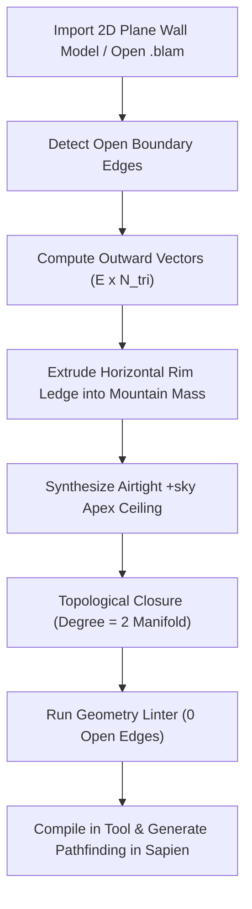

# ForgeWorks Studio - Blam Editing Suite For Halo 3 (v2.4.0)

[](https://dotnet.microsoft.com/)
[](https://store.steampowered.com/app/976730/Halo_The_Master_Chief_Collection/)
[](https://avaloniaui.net/)
[](https://github.com/dotnet/Silk.NET)
[](https://fsharp.org/)
[](CHANGELOG.md)

**ForgeWorks Studio** is an all-in-one desktop environment designed specifically for Halo 3 Blam! Engine level design, DCC modeling, tag editing, and automated map compilation. It unifies previously fragmented community toolchains into a modern workstation combining procedural level design, 3D DCC blockout, Sapien scenario placement, Guerilla binary tag reflection, and 1-click compilation into Halo: The Master Chief Collection (MCC).

> [!NOTE]
> For detailed version history, patch notes, and technical fix summaries, please see [CHANGELOG.md](CHANGELOG.md).

---

## What the Tool is Capable Of

### 1. DCC 3D Modeling & Level Blockout
- **Sub-Element Selection Modes**: Full Object (`1`), Vertex (`2`), Edge (`3`), and Face (`4`) selection.
- **Topology Operations**: Face Extrusion (`E`), Insetting (`I`), Loop Cuts (`K`), Face Dissolution (`X`), Surface Subdivision, Normal Inversion, and Clean Mesh Merging.
- **3D Procedural Primitives**: Instant generation of Cubes/Boxes, Cylinder Pillars, Spheres, Cones, Torus Rings, Ground Planes, Wedge Ramps, and Hollow Rooms with customizable wall thickness.
- **Interactive Transform Gizmos**: Screen-space projected Translation, Rotation, and Scaling gizmos with live numeric feedback.

### 2. Procedural Terrain & Water Generation
- **Fast Multithreaded Noise**: Simplex, Perlin, and Cellular (Voronoi) heightmap generation with hydraulic erosion and thermal smoothing.
- **10 Landscape Presets**: *Mountain Pass Valley*, *Canyon Gorge*, *Rolling Hills*, *Meteor Crater*, *Mesa Plateau*, *Desert Dunes*, *Island Atoll*, *Terraced Canyon*, *Radial Basin Arena*, and *Mesa Arena*.
- **Authentic Blam 4-Channel Water**:
  - Direct synthesis of `river riverworld_water_rough'` water volumes fitted to terrain contours.
  - Multi-stream UV layout compliant with Halo 3's `.shader_water` pipeline:
    - **UV0**: Visual ripple tiling repeat.
    - **UV1**: Wave displacement magnitude & depth color tint `(1.0, 1.0)`.
    - **UV2**: Shader index alignment.
    - **UV3**: Normalized `[0, 1]` global surface shape mask.
  - Translucent real-time water viewport shader with procedural waves, specular highlights, and underwater terrain depth transparency.

### 3. Universal 3D Asset Importer (FBX, OBJ, ASS)
- **FBX Hierarchy & Pivot Normalization**: Automatically collapses Assimp dummy pivot offset nodes (`IMPORT_FBX_PRESERVE_PIVOTS = false`) and strips internal tags, eliminating misplaced sub-meshes and broken multi-part assemblies.
- **Coordinate Space Conversion**: Maps $Y$-up models cleanly into Halo 3's native $Z$-up right-handed coordinate system.
- **Multi-Material Slots**: Automatically parses materials and maps textures directly to Halo retail shader equivalents.
- **Collision Flag Detection**: Identifies floating light cards, decals, and lens flares to mark them render-only (`!`) with collision disabled, preventing collision BSP open-edge errors.

### 4. Halo 3 Mesh Fixing Suite & AI Pathfinding Sealer
- **2D Plane Wall Outward Rim & Sky Seal Math**: Detects open cliff perimeter edges, extrudes horizontal rim ledges into mountain masses, and connects them to a downward-facing `+sky` apex ceiling cap. Converts open meshes into **100% airtight 2-manifold closed surfaces (degree = 2, 0 open edges)**, allowing Sapien's `generate-pathfinding` algorithm to compile without errors.
- **Mesh Diagnostics & Geometry Linter**: Scans models for degenerate triangles, non-manifold edges, coplanar overlapping faces, and open seams.
- **Low-Poly QEM Mesh Decimator**: Quadric Error Metric mesh reduction (25%, 50%, 75%, or target polygon count) optimized for Blam BSP cluster performance.

### 5. Continuous Triplanar UV Mapping Engine
- **1:1 World-Space Continuous UVs**: Eliminates UV stretching and distortion across complex organic terrain and cliff faces without manual UV unwrapping.
- **Seam-Split Triplanar Mapping**: Splits UVs along hard angle thresholds for zero texture warping on sharp architectural edges.
- **Dedicated Planar Projections**: Ground (XY), Cliff Wall (XZ), and Side Wall (YZ).

### 6. Integrated Sapien Scenario Placement
- **Dynamic Entity Placement**: Place player spawn points, starting orientations, weapons, vehicles, equipment, and netgame flags directly in the 3D viewport.
- **Scenario Tag Reflection**: In-memory inspection and mutation of `.scenario` reflexives with automatic retail template synthesis.
- **Project Isolation**: Guarantees new levels always clone pristine retail templates (`chill.scenario` or `bunkerworld.scenario`), preventing assets or spawns from previous projects from bleeding across maps.

### 7. One-Click MCC Compilation Bridge
- **Direct ASS v3 Stream Exporter**: Exports Amalgam Scene Specification v3 geometry formatted strictly for Halo 3's `tool_fast.exe structure` parser.
- **Automated Pipeline Orchestration**: Automatically sets up level directory structures (`data\levels\multi\<name>\` and `tags\levels\multi\<name>\`), converts textures to power-of-two uncompressed TIFFs, compiles `.bitmap` and `.shader` tags, builds the structure BSP, patches scenario indices, and builds the playable `.map` cache file.
- **Instant Launch**: One-click launching into `sapien.exe` or Halo: The Master Chief Collection.

---

## Subsystem Architecture

```text
Forgeworks Halo 3/
├── Compile_ForgeWorks.bat       # One-click build and automated test runner
├── Launch_ForgeWorks.bat        # One-click application launcher (Release/Debug)
├── Publish_ForgeWorks.bat       # One-click standalone single-file .exe publisher
├── ForgeWorks.slnx              # Visual Studio / Rider solution
├── CHANGELOG.md                 # Complete version history and patch notes
├── My Projects/                 # Default storage for .blam project container files
├── src/
│   ├── ForgeWorks.Core/         # Geometry, DCC modeling, QEM decimation, UV engine, auto-repair
│   ├── ForgeWorks.Blam/         # Tag structures, ASS exporter/importer, scenario patching, compiler
│   ├── ForgeWorks.FSharp/       # High-performance mesh math, 2D plane rim & sky topology, noise
│   └── ForgeWorks.UI/           # Avalonia 11 desktop shell, Silk.NET OpenGL 3.3 viewport, MVVM
└── tests/
    ├── ForgeWorks.Tests/        # Comprehensive automated unit and regression test suite
    ├── generate_2d_wall_rim.fsx # Standalone F# rim & sky seal script
    └── run_icefields_pipeline.fsx # Standalone F# automated Icefields porting pipeline
```

---

## How-To Guides

### 1. System Requirements & Prerequisites
- **Operating System**: Windows 10 or Windows 11 (64-bit).
- **.NET SDK**: [.NET 10.0 SDK](https://dotnet.microsoft.com/download/dotnet/10.0) or later.
- **Editing Kit**: **Halo 3 Editing Kit (H3EK)** installed via Steam or MCC Mod Tools (e.g. `C:\Program Files (x86)\Steam\steamapps\common\H3EK`).

---

### 2. How to Compile into a Working Standalone `.exe`

#### Option A: One-Click Publisher Script (Recommended)
Double-click [`Publish_ForgeWorks.bat`](Publish_ForgeWorks.bat) in the repository root. This will:
1. Compile the solution in `Release` configuration for `win-x64`.
2. Bundle the .NET runtime, Avalonia desktop libraries, Silk.NET, and Assimp native assemblies into a single self-contained executable.
3. Output the standalone application to `publish\ForgeWorks.UI.exe`.

#### Option B: Terminal Command Line
```powershell
dotnet publish src/ForgeWorks.UI/ForgeWorks.UI.csproj -c Release -r win-x64 --self-contained -p:PublishSingleFile=true -p:IncludeNativeLibrariesForSelfExtract=true -o publish
```

---

### 3. How to Launch ForgeWorks Studio

#### Option A: One-Click Launcher Script
Double-click [`Launch_ForgeWorks.bat`](Launch_ForgeWorks.bat) in the repository root.

#### Option B: Terminal Command Line
```powershell
dotnet run --project src/ForgeWorks.UI -c Release
```

#### Option C: Run the Published Standalone Executable
Navigate to the `publish\` folder and run `ForgeWorks.UI.exe`.

---

### 4. How to Create and Compile a Map from Scratch

1. **Launch ForgeWorks Studio**.
2. **Start a New Project**:
   - Click `📄 New Project` (or press `Ctrl + N`).
3. **Configure H3EK Path & Level Name**:
   - In the top bar, enter your map's name in the **Level** field (e.g. `delta_canyon`).
   - Confirm your **H3EK** root directory (e.g. `C:\Program Files (x86)\Steam\steamapps\common\H3EK`).
   - Click **📁 Setup Folders**: ForgeWorks creates the required directory tree under `data\levels\multi\delta_canyon\` and `tags\levels\multi\delta_canyon\` and synthesizes an isolated `.scenario` tag based on retail templates.
4. **Generate Terrain with Water**:
   - Open the **Terrain Presets** panel and choose a preset (e.g. *Canyon Gorge* or *Radial Basin Arena*).
   - Check **Generate Water** and set the **Water Elevation** to desired height.
   - Click **Generate Terrain**: A procedural terrain mesh and a fitted 4-channel Riverworld water plane will be spawned into the scene.
5. **Add Buildings or Blockout**:
   - Go to `Edit -> Spawn Primitive` to spawn boxes, cylinder pillars, wedge ramps, or hollow rooms.
   - Press `Q` to switch to **Edit Mode**, press `4` to enter **Face Selection**, and extrude (`E`) or inset (`I`) doorways and corridors.
6. **Assign Materials & UVs**:
   - In the right-hand **Inspector**, select a material from the **Halo 3 Retail Shader Palette** (e.g. `mpshare mp_sand` or `snow_ice_solid`).
   - Click `Edit -> Seamless UV Mapping -> Apply Seamless Triplanar UVs (1:1 World-Space)`.
7. **Compile with 1-Click**:
   - Click `File -> 1-Click Compile & Build` (or click `⚡ Compile Structure BSP` in the bottom bar).
   - ForgeWorks exports `delta_canyon.ass`, runs `tool_fast.exe structure`, patches the scenario tag, and builds the level BSP.
8. **Launch into Sapien or MCC**:
   - Click **Launch Sapien** to inspect spawns, AI paths, and lighting directly inside the engine.

---

### 5. How to Import FBX / OBJ Models Cleanly

1. Click `File -> Import 3D Geometry` (or press `Ctrl + I`).
2. Select your `.fbx` or `.obj` file.
3. ForgeWorks automatically:
   - Evaluates FBX pivot matrices into vertex transforms, eliminating misaligned sub-meshes.
   - Maps $Y$-up models to Halo 3's native $Z$-up orientation.
   - Preserves all sub-mesh hierarchies and multi-material slot assignments.
4. If the imported model has single-sided cliff wall planes, proceed to Guide #6.

---

### 6. How to Fix 2D Plane Wall Maps for Sapien AI Pathfinding

When importing maps with single-sided 2D cliff walls (e.g. Icefields or custom terrain rips), open edges cause Sapien's `generate-pathfinding` algorithm to abort:



1. Select your terrain mesh in the Outliner.
2. In the right panel, open the **`🛠️ Errors & Fixer`** tab.
3. Click **`🏔️ Generate Rim for 2D Plane Walls with Sky`**.
4. The status bar will confirm:
   ```text
   Generated rim and sky ceiling on 'cliff_walls': Open edges: 0! Mesh is 100% sealed for Sapien AI pathfinding.
   ```
5. Click **`Run Geometry Linter`** to confirm 0 open edges.
6. Click **`1-Click Compile & Build`**.
7. In Sapien, open the console (`~`) and execute:
   ```text
   generate-pathfinding
   ```
   The AI pathfinding graph will compile cleanly with 0 errors.

---

### 7. Headless & Automated F# Script Workflows

For command-line batch pipelines without launching the GUI:

#### A. Generate Rim and Sky Seal on any Model or Project File
```powershell
dotnet fsi tests/generate_2d_wall_rim.fsx "My Projects/custom_canvas.blam"
```

#### B. Full Automated Icefields Port & Compilation Pipeline
```powershell
dotnet fsi tests/run_icefields_pipeline.fsx
```

---

## Keyboard Shortcuts Quick Reference

| Shortcut | Action |
| :--- | :--- |
| **`Ctrl + N`** | New Project (clean scene graph and palette) |
| **`Ctrl + S`** | Save current `.blam` project |
| **`Ctrl + Shift + S`** | Save `.blam` project as new file |
| **`Ctrl + O`** | Open `.blam` project file |
| **`Ctrl + I`** | Import 3D Geometry (FBX, OBJ, ASS) |
| **`Ctrl + Z`** | Undo last geometry or transform action |
| **`Ctrl + Y`** | Redo last undone action |
| **`Ctrl + D`** | Duplicate selected object |
| **`Delete`** | Delete selected object or dissolve selected faces |
| **`1`** | Object Selection Mode |
| **`2`** | Vertex Selection Mode |
| **`3`** | Edge Selection Mode |
| **`4`** | Face Selection Mode |
| **`E`** | Extrude selected faces along normal |
| **`I`** | Inset selected faces |
| **`K`** | Loop cut active mesh |
| **`X`** | Dissolve selected faces |

---

## License

This project is built for the Halo modding community and is compliant with Microsoft's [Game Content Usage Rules](https://www.xbox.com/en-US/developers/rules). Halo 3 is a registered trademark of Microsoft Corporation / 343 Industries.
