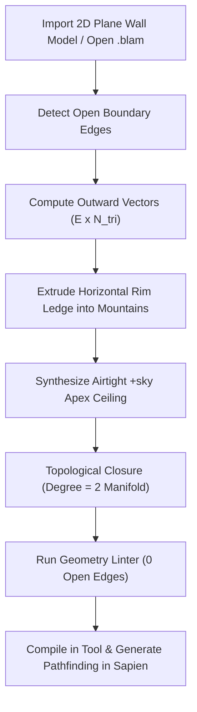

# ForgeWorks Studio - Blam Editing Suite For Halo 3 (v2.3.3)

[](https://dotnet.microsoft.com/)
[](https://store.steampowered.com/app/976730/Halo_The_Master_Chief_Collection/)
[](https://avaloniaui.net/)
[](https://github.com/dotnet/Silk.NET)
[](https://fsharp.org/)

**ForgeWorks Studio** is the definitive, all-in-one desktop environment designed specifically for Halo 3 Blam! Engine level design, DCC modeling, tag editing, and automated map compilation. It consolidates previously fragmented toolchains into a modern, high-performance workstation:

1. **DCC 3D Modeling & Blockout**: Full sub-element face, edge, vertex, and object selection, face extrusion, insetting, loop cuts, face dissolution, normal flipping, 3D primitives, and CSG Boolean operations.
2. **Halo 3 Mesh Fixing Suite**: Advanced mathematical topology algorithms (F# + C#) designed to eradicate all open edges, coplanar overlapping faces, and non-manifold surfaces that cause tool compilation errors and Sapien AI pathfinding crashes.
3. **Continuous Triplanar UV Mapping**: 1:1 world-space triplanar projection and zero-distortion seam-split remapping across any surface curvature.
4. **Integrated Sapien Viewport**: 60+ FPS hardware-accelerated OpenGL 3.3 renderer with interactive 3D transform gizmos (Translate, Rotate, Scale), outliner hierarchy, scenario palette, and live entity editing.
5. **Integrated Guerilla Tag Reflection**: In-memory inspection and mutation of `.scenario`, `.shader`, and `.bitmap` reflexives with automated retail template synthesis.
6. **One-Click MCC Compilation**: Direct export to `.ass` (Amalgam Scene Specification v3) and automated streaming compilation via `tool_fast.exe` with instant launching into Sapien and MCC.

---

## What's New in v2.3.3 (ASS v3 Structure Compiler Fatal Error Hotfix)

### 1. Fix ASS v3 Vertex Node Influences & Texcoords Negative Count Crash
- **Root Cause Identified**:
  In ASS (Amalgam Scene Specification) version 3, the vertex data format consumed by Halo 3's `tool_fast.exe structure` parser expects:
  1. Position: `X Y Z` (3 floats)
  2. Normal: `I J K` (3 floats)
  3. Node influences count: `0` (1 integer)
  4. Texcoords count: `N` (1 integer)
  5. Texcoords: `U V` (2 floats per UV; **not** 3-tuple `U V 0.0`)
  Vertex color (`R G B`) lines were only introduced in ASS version 6+ (v6, v7). Because `AssExporter.cs` was unconditionally serializing vertex colors and 3-tuple UV coordinates even when exporting header version 3, Tool's token parser read the vertex color floats as integer counts for node influences and UV counts. This desynchronized token consumption across vertex boundaries, causing Tool to read the negative coordinates of subsequent vertices (`-4069.1489` and `-6750.0000`) as counts and fail fatally:
  ```
  -FATAL- mesh definition vertex node influences count invalid: #-4069 negative
  -FATAL- mesh definition vertex texcoords count invalid: #-6750 negative
  -FATAL- couldn't parse definition #0
  -FATAL- couldn't parse file 'data\levels\multi\custom_canvas\structure\custom_canvas.ass'
  -ERROR- structure import pipeline failed for levels\multi\custom_canvas\custom_canvas
  ```
- **The Fix**:
  - In `AssExporter.cs`, guarded vertex color serialization with `if (version >= 6)` so that ASS v3 geometry complies strictly with the v3 token format.
  - Guarded 3-tuple UV serialization with `if (version >= 5)`; ASS v3 exports clean 2-tuple `u v` coordinates.
  - Updated mesh object header to write the object name `"{obj.Name}"` instead of an anonymous empty string.
  - In `AssImporter.cs`, updated the vertex parser to only consume vertex color lines when `headerVersion >= 6`.
  - In `MainViewModel.cs`, passed `levelName: ActiveLevelName` during 1-Click Compiler export to guarantee collection prefixes are resolved.
  - Added unit regression test `AssExporter_AssV3_DoesNotWriteVertexColorsOr3dUVs_FixingToolNodeInfluencesFatalError` and updated `AssExporter_ExportsVertexColorsInVersion7`.

---

## What's New in v2.3.2 (Compiler Fatal Error & Water Rendering Hotfix)

### 1. Fix ASS v3 Material Parser Crash (`-FATAL- material shader string is missing quotes: '0'`)
- **Root Cause Identified**: In ASS (Amalgam Scene Specification) version 3—the native geometry format consumed by Halo 3's `tool_fast.exe structure` pipeline—material definitions consist solely of:
  1. Material name string (quoted, e.g. `"base_rock"`)
  2. Material variant string (quoted, e.g. `""`)
  Unlike ASS version 4+ (which introduces property counts and key-value properties), ASS v3 does **not** read a property count integer. Because `AssExporter.cs` was unconditionally writing a property count line `"0"` after every material variant, Tool's Lexer/Parser read `"0"` as the next material's shader name string. Since `"0"` lacked quotation marks, Tool aborted immediately with:
  `-FATAL- material shader string is missing quotes:  '0'`
  `-FATAL- couldn't parse material #1`
  `-FATAL- couldn't parse file 'data\levels\multi\custom_canvas\structure\custom_canvas.ass'`
  `-ERROR- structure import pipeline failed for levels\multi\custom_canvas\custom_canvas`
- **The Fix**:
  - In `AssExporter.cs`, guarded property count serialization with `if (version >= 4)`. For ASS v3 files, only the material name and variant lines are written.
  - In `AssImporter.cs`, updated the material parser to inspect the header version (`headerVersion >= 4`) before attempting to parse and consume property count lines.
  - Added unit regression test `AssExporter_AssV3_DoesNotWritePropertyCountZero_FixingToolMaterialShaderFatalError` verifying round trips and zero unquoted tokens in ASS v3 output.

### 2. PNG-to-TIFF Bitmap Conversion with Power-of-Two Scaling & GDI+ Tag Stripping
- **Root Cause Identified**: When importing PNG textures to generate `.bitmap` tags, users encountered errors and libtiff warnings such as:
  `TIFFReadDirectory: Warning, data\levels\multi\custom_canvas\bitmaps\<name>.tif: unknown field with tag 20752 (0x5110) encountered.`
  Standard GDI+ `image.Save(..., ImageFormat.Tiff)` writes private Windows EXIF/property tags (`0x5110`, `0x5111`, `0x5112`, `0x0301`, `0x0303`), non-power-of-two dimensions, and compressed or variable strip encodings that fail or throw warnings in `tool.exe bitmaps`.
- **The Fix**:
  - In `CustomShaderBuilder.cs`, revamped `ConvertImageToTif`:
    - Reads raw image bytes into memory first to avoid file-locking on disk.
    - Clamps and scales texture dimensions to power-of-two (64, 128, 256, 512, 1024, 2048, 4096) using high-quality bicubic resampling.
    - Normalizes pixel format to 32bpp ARGB (`Format32bppArgb`).
    - Strips all private GDI+ property items before saving.
    - Saves clean, uncompressed TIFF strips using `EncoderValue.CompressionNone` (`System.Drawing.Imaging.Encoder.Compression`).
  - Added unit regression test `CustomShaderBuilder_ConvertImageToTif_ConvertsPngCleanly_WithPowerOfTwoAndNoExifTags` verifying power-of-two dimensions and complete absence of private tags `0x5110`, `0x5111`, and `0x5112`.

### 3. Realistic Water Rendering & Depth Mask Fix in Silk.NET Viewport
- **Root Cause Identified**: Water surfaces in the 3D viewport had several visual defects:
  1. Water meshes wrote their depth values into the OpenGL depth buffer (`glDepthMask(GL_TRUE)`). This caused the top surface of lakes and rivers to completely occlude underwater riverbeds, rocks, and terrain.
  2. Water was rendered under `ModeLitSolid` and multiplied by standard diffuse lighting, turning water dark muddy grey/black in shadowed or ambient-lit environments.
  3. Meshes with names or materials containing `lake`, `ocean`, `river`, `pond`, etc. were not recognized as transparent water, causing them to render as opaque solid geometry.
  4. Cube-generated water volumes had averaged normals at corner vertices, slanting the water surface reflections at 45-degree angles.
- **The Fix**:
  - In `StructureGenerator.cs`, `GenerateWaterVolume` now forces top water vertices ($z = \text{max}$) to have pure upward normal `Vector3.UnitZ`, ensuring true horizontal surface reflections.
  - In `BlamViewportControl.cs`:
    - Added dedicated shader mode `ModeWater = 3` with translucent cyan coloring (`vec4(0.10, 0.54, 0.85, 0.62)`), procedural wave distortion, specular sunlight highlight (`pow(max(dot(n, halfDir), 0.0), 36.0) * 0.70`), and fresnel rim reflection.
    - Implemented `IsWaterMaterial(...)` identifying keywords: `water`, `lake`, `ocean`, `river`, `pond`, `swamp_water`, `waterfall`, and `riverworld_water`.
    - Wrapped transparent passes with `_gl.DepthMask(false)` and `_gl.DepthMask(true)`, allowing underwater terrain and lakebeds to render clearly beneath the translucent water surface.
  - Added unit regression test `BlamViewportControl_IsWaterMaterial_DetectsAllWaterVariations`.

---

## What's New in v2.3.1 (Integrity & Tool Compiler Hotfix Patch)

### 1. Fix Shader Corruption Bug (`\sd1, 1836345698`)
- **Root Cause Identified**: The integer `1836345698` is hexadecimal `0x6D736872` ("rmsh" in ASCII little-endian). The previous tag builder synthesized bare `"rmsh"` at offset 0 without the required serialized tag layout chunks, causing Tool's tag parser to read `"rmsh"` as an integer and abort. Additionally, a naive global ASCII search for `bitm` matched the word `bitmap` inside the tag layout's string table at offset `0x169`, triggering self-matching cascading corruption whenever the inserted bitmap path contained `\bitmaps\`.
- **The Fix**:
  - Completely eliminated naive ASCII regex byte scanning and raw string-table surgery in `CustomShaderBuilder.cs`.
  - Disabled pseudoheader synthesis; authentic retail templates (`chill_metal.shader`, `chill_snow.shader`, etc.) are preserved and copied directly.
  - Pre-existing valid shaders (> 1KB) are preserved untouched.
  - Added regression test `CustomShaderBuilder_PreservesTemplateIntegrity_AndDoesNotCorruptStringTable` ensuring string table bytes at offset `0x169` remain identical.

### 2. Material Flags & Punctuation Preservation (Fixing 1,672 Red/Blue Collision Open Edges)
- **Root Cause Identified**: In Icefields, light cards and decals are floating 2D open surfaces. Previous material sanitization in `AssExporter.cs` stripped suffix flags like `!` and `%` into underscores (`lights!` $\rightarrow$ `icefields lights_`), while `CustomShaderBuilder.cs` skipped `!lights` and collapsed plural `lights` into singular `light`. This caused 23 missing-shader errors AND stripped the render-only flag (`!`), forcing Tool to process 2D floating card polygons as solid collision BSP—generating **1,672 red and blue collision open-edge errors** (80.35% of all edge errors in Icefields).
- **The Fix**:
  - `AssExporter.SanitizeMaterialName` now extracts all suffix and prefix flags (`!`, `%`, `*`, `$`, `@`, `~`) and normalizes them into standard Blam semantic prefixes without converting punctuation to underscores (e.g. `lights!` $\rightarrow$ `!icefields lights`).
  - `UniversalGeometryImporter` inspects Assimp two-sided flags and keyword hints (`light`, `lens`, `glow`, `decal`), assigning `!` prefix and setting `meshObj.IsCollideable = false` so floating cards are excluded from collision BSP generation.
  - `CustomShaderBuilder` preserves render-only (`!`) and two-sided (`%`) materials during shader setup, canonicalizing names cleanly without collapsing plural `lights` to singular `light`.

### 3. ASS v3/v7 Material Property Consumption & Multi-Material Slots
- **Root Cause Identified**: In `AssImporter.cs`, the material parser read the variant line but failed to read the property count integer $P$ and consume the $P$ property lines, causing property counts like `"0"` to be misread as subsequent material names. Furthermore, triangle imports overwrote `MaterialName` without populating `MaterialSlots`.
- **The Fix**:
  - `AssImporter` now parses the property count integer and consumes all property lines according to the ASS v3/v7 specification.
  - Added `ImportFromStream` and `ImportFromReader` overloads.
  - Populates `mesh.MaterialSlots` with all materials declared in the ASS header, maintaining multi-material triangle indices during round trips.
  - `AssExporter` writes the exact header version requested instead of hardcoded `"7"`.

### 4. ToolFast Compiler Error Classification & Output Freshness
- **The Fix**:
  - Enhanced `ToolFastCompiler.cs` to classify `-ERROR-`, `-FATAL-`, `### ERROR`, `failed to load shader`, and fallback-shader failures across all compilation stages (`structure`, `light`, `build-cache-file`).
  - Implemented timestamp tracking (`bspStartTimeUtc`, `cacheStartTimeUtc`) and freshness validation to verify generated `.scenario_structure_bsp` and `.map` files are strictly newer than the compile invocation, preventing stale artifacts from masking compilation failures.

### 5. Guarded Sapien Mode Transition
- **The Fix**:
  - `MainViewModel.CompileAndEnterSapienAsync` now checks `bool success = await CompileStructureAsync()`.
  - The application enters Sapien mode **only upon verified compile success**, keeping failure logs and diagnostic status visible when compilation fails.

---

## What's New in v2.3.0

### 1. 2D Plane Wall Outward Rim & Sky Seal Math (`Generate Rim for 2D Plane Walls with Sky`)
- **The Problem**: Legacy maps, game rips, and heightmap terrains (such as Ice Fields and `customcanvas.blam`) frequently feature 2D single-sided cliff wall planes whose top and boundary edges are completely open to the void.
- **The Consequence**: When open edges exist, **Sapien's `generate-pathfinding` algorithm fails completely**. Sapien uses directional flood-fill raycasts to compute walkable AI navigation volumes; open edges allow rays to escape into infinity, aborting pathfinding generation with hundreds of red `open edge` errors.
- **The Solution**:
  - Implemented analytical boundary detection in F# (`ForgeWorks.FSharp.Topology.generateRimFor2dPlaneWallsWithSky`) and C# (`GeometryAutoRepair.GenerateRimFor2dPlaneWallsWithSky`).
  - Automatically calculates outward horizontal rim vectors ($E \times N_{tri}$) along boundary edges, extruding a solid horizontal ledge outward into the mountain mass.
  - Generates an airtight downward-facing `+sky` dome ceiling cap connecting down to this rim with 1:1 vertex sharing.
  - Converts open 2D cliff walls into a **100% watertight 2-manifold closed surface** (degree = 2 for every edge, 0 open edges).
  - Dedicated UI option and button: **"Generate Rim for 2D Plane Walls with Sky"** in the `Mesh`, `Halo 3 Tools`, and `🛠️ Errors & Fixer` panels.

### 2. Standalone Automation Scripts (F#)
- Added [`tests/generate_2d_wall_rim.fsx`](file:///c:/Users/Chey1/Desktop/Forgeworks%20Halo%203/tests/generate_2d_wall_rim.fsx): Standalone command-line script to inspect any model (`.obj`, `.fbx`, `.ass`) or `.blam` project file (such as `My Projects/customcanvas.blam`), apply the 2D plane rim and sky seal math, eliminate open edges, and save the result.
- Updated [`tests/run_icefields_pipeline.fsx`](file:///c:/Users/Chey1/Desktop/Forgeworks%20Halo%203/tests/run_icefields_pipeline.fsx) to automatically seal Icefields cliff boundaries using `GenerateRimFor2dPlaneWallsWithSky`.

### 3. Dedicated Project Persistence (`.blam` Format)
- Implemented native project save/load system using `.blam` JSON container files.
- Automatically organizes and discovers projects in the local `My Projects/` workspace directory.
- Preserves all scene nodes, imported meshes, vertex colors, multi-material slot assignments, 1:1 Blam shader paths, and transform hierarchies.
- Full keyboard shortcuts: `Ctrl+S` (Save), `Ctrl+Shift+S` (Save As), `Ctrl+O` (Open).

### 4. Seamless UV Mapping & Remapping Engine
- **Continuous Triplanar UVs (1:1 World-Space)**: Automatically maps texture coordinates proportionally across X, Y, and Z axes without seam tearing or stretching.
- **Seam-Split Triplanar UVs**: Splits UV seams at hard angle thresholds for zero-distortion texture alignment.
- **Dedicated Planar Projections**: Ground (XY), Cliff Wall (XZ), and Side Wall (YZ).

### 5. Low-Poly QEM Mesh Decimation Suite
- Fast Quadric Error Metric (QEM) decimation to reduce high-polygon imported models down to Halo 3 cluster budgets:
  - 25% Reduction (Mild Optimization)
  - 50% Reduction (Standard Low-Poly)
  - 75% Reduction (Aggressive Low-Poly)
  - Target Triangle Budget (e.g. 10,000 triangles for optimal BSP cluster performance)

### 6. Branding & Overhead Cleanup
- Cleaned up application overhead and user interface: replaced all legacy Blockbench and Godot references with **Blam Editing Suite For Halo 3**.

---

## Why Open Edge Errors Break Sapien AI Pathfinding

> [!IMPORTANT]
> **Understanding Blam! Engine AI Navigation Constraints:**
> Halo 3's AI pathfinding system in `sapien.exe` (`generate-pathfinding`) operates by casting geometric flood-fill rays across all walkable collision surfaces (`+collision` or default materials) starting from player and spawn seeds.
> 
> - If any boundary edge is **open** (connected to only 1 triangle instead of 2), pathfinding rays leak into the infinite void.
> - Sapien detects this non-manifold topology, marks the boundary with bright red **`open edge`** flags, and immediately aborts the pathfinding generation process.
> - Spawning a generic disconnected box over an open cliff does **not** fix the issue because the boundary edges still remain disconnected and unsealed.
> - **The ForgeWorks Solution**: `Generate Rim for 2D Plane Walls with Sky` extrudes the open edge perimeter outward by a configurable distance (default: 400 units), bridges the gap with manifold quads, and connects the outer rim vertices directly to a central downward-facing `+sky` apex cap. This ensures that every single edge in the mesh has an exact topological degree of 2, achieving a 100% airtight manifold seal and allowing Sapien AI pathfinding to compile with zero errors.

---

## Core Functions & Subsystems

| Subsystem | Key Capabilities |
| :--- | :--- |
| **DCC 3D Modeling Suite** | Sub-element selection (`1`=Object, `2`=Vertex, `3`=Edge, `4`=Face), Extrude (`E`), Inset (`I`), Loop Cut (`K`), Dissolve (`X`), Flip Normals, Subdivide, Clean Merge Meshes, Fit Scene to Grid. |
| **3D Primitives Spawner** | Cube/Box, Cylinder Pillar, Sphere, Cone, Torus Ring, Plane/Floor, Wedge Ramp, Hollow Room with customizable dimensions and wall thickness. |
| **Halo 3 Mesh Fixing Suite** | **Generate Rim for 2D Plane Walls with Sky**, Deduplicate Overlapping Surfaces, Seal Boundary Open Edges Down to Floor, Auto-Seal Entire Map (+sky Dome), QEM Decimator, Swampthing Auto-Weld. |
| **UV Mapping Engine** | Seamless Triplanar UVs (1:1 World-Space), Seam-Split Zero-Distortion UVs, Planar Ground (XY), Planar Cliff Wall (XZ), Planar Side Wall (YZ). |
| **Procedural Terrain & Presets** | Fast Simplex, Perlin, and Cellular Voronoi generation with 10 presets: *Mountain Pass Valley*, *Canyon Gorge*, *Rolling Hills*, *Meteor Crater*, *Mesa Plateau*, *Desert Dunes*, *Island Atoll*, *Terraced Canyon*, *Radial Basin Arena*, *Mesa Arena*. |
| **Procedural Structures** | Automated UNSC Bunkers, sealed water volumes, hallway airlocks (`+portal`), chokepoints, rock archetypes, and foliage scattering. |
| **Scenario & Sapien Placement** | Interactive 3D gizmos (Translate, Rotate, Scale) with screen-space axis projection, player spawn points, weapons, vehicles, starting orientations, trigger volumes, and kill zones. |
| **Guerilla Tag Mutator** | In-memory reflection viewer and editor for scenario and shader reflexives, automatic retail `.shader` template synthesis, and `.bitmap` compilation. |
| **Compiler & Bridge** | Direct `.ass` (v3) export, streaming compilation with `tool_fast.exe structure` and `build-cache-file`, automated log parsing, and 1-click launch into Sapien and MCC. |

---

## How-To Guides

### 1. Prerequisites & System Requirements
- **OS**: Windows 10 or Windows 11 (64-bit).
- **.NET SDK**: [.NET 10.0 SDK](https://dotnet.microsoft.com/download/dotnet/10.0) or later.
- **Editing Kit**: **Halo 3 Editing Kit (H3EK)** installed via Steam or MCC Mod Tools (e.g., `C:\Program Files (x86)\Steam\steamapps\common\H3EK`).

---

### 2. How to Compile & Build the Project

#### Option A: One-Click Windows Batch Script (Recommended)
Double-click [`Compile_ForgeWorks.bat`](file:///c:/Users/Chey1/Desktop/Forgeworks%20Halo%203/Compile_ForgeWorks.bat) in the repository root. This script will:
1. Verify the .NET SDK installation.
2. Build the solution in `Release` configuration.
3. Run the automated test suite to verify all systems.

#### Option B: Terminal Command Line
```powershell
# Restore and build the solution in Release mode
dotnet build -c Release

# Run the test suite
dotnet test -c Release --no-build
```

---

### 3. How to Launch the Application

#### Option A: One-Click Windows Batch Script
Double-click [`Launch_ForgeWorks.bat`](file:///c:/Users/Chey1/Desktop/Forgeworks%20Halo%203/Launch_ForgeWorks.bat) in the repository root.

#### Option B: Terminal Command Line
```powershell
dotnet run --project src/ForgeWorks.UI -c Release
```

---

### 4. How to Generate Maps from Scratch (Complete Workflow)

1. **Launch ForgeWorks Studio**.
2. **Configure H3EK Path & Level Name**:
   - In the top bar, enter your map's name in the **Level** field (e.g. `delta_canyon`).
   - Confirm your **H3EK** path (e.g. `C:\Program Files (x86)\Steam\steamapps\common\H3EK`).
   - Click **📁 Setup Folders**: ForgeWorks will automatically create the required directories under `data\levels\multi\delta_canyon\` and `tags\levels\multi\delta_canyon\` and synthesize a valid base `.scenario` tag.
3. **Generate Terrain or Blockout**:
   - Go to `Procedural Generation -> Terrain Presets` and choose a layout (e.g. *Canyon Gorge* or *Radial Basin Arena*), OR
   - Go to `Edit -> Spawn Primitive` to build structures using cubes, cylinders, wedge ramps, and hollow rooms.
4. **Sculpt and Shape**:
   - Switch to **Edit Mode** (`Q`) or **Sculpt Mode**.
   - Use Face Mode (`4`) to select surfaces and extrude hallways (`E`) or inset rooms (`I`).
5. **Assign Materials & UVs**:
   - In the **Inspector** (right panel), select a material from the **Halo 3 Retail Shader Palette** (e.g. `mpshare mp_sand` or `snow_ice_solid`).
   - Click `Edit -> Seamless UV Mapping -> Apply Seamless Triplanar UVs (1:1 World-Space)` to texture the geometry without seams.
6. **Seal the Map for AI Pathfinding**:
   - If your map has 2D plane cliff walls, click `🏔️ Generate Rim for 2D Plane Walls with Sky` in the `🛠️ Errors & Fixer` tab.
   - Alternatively, click `🌐 Auto-Seal Entire Map (+sky)` to generate an airtight sky dome over the entire map.
7. **Compile with 1-Click**:
   - Click `File -> 1-Click Compile & Build` (or click `⚡ Compile Structure BSP` in the bottom bar).
   - ForgeWorks will export `delta_canyon.ass`, execute `tool_fast.exe structure`, compile the BSP, patch the scenario tag, and stream compilation logs directly into the bottom console.
8. **Launch in Sapien**:
   - Click `Launch Sapien` in the bottom bar to open `sapien.exe` directly into your newly compiled level.

---

### 5. How to Fix Maps with 2D Plane Walls for Sapien AI Pathfinding

When importing maps with single-sided 2D cliff walls (e.g., Ice Fields or `customcanvas.blam`):



1. Open your project or import your model (`File -> Open Project (.blam)...` or `File -> Import 3D Geometry`).
2. Select the cliff/terrain mesh in the Outliner.
3. Open the **`🛠️ Errors & Fixer`** tab on the right panel.
4. Click the blue **`🏔️ Generate Rim for 2D Plane Walls with Sky`** button (or choose `Edit -> 🛡️ Halo 3 Mesh Fixing Suite -> 🏔️ Generate Rim for 2D Plane Walls with Sky`).
5. Notice the status bar confirm:
   ```text
   Generated rim and sky ceiling on 'cliff_walls': Added 342 rim triangles and 172 sky triangles. Open edges: 0! Mesh is 100% sealed for Sapien AI pathfinding.
   ```
6. Click **`Run Geometry Linter`** to confirm 0 open edges.
7. Click **`1-Click Compile & Build`**.
8. In Sapien, open the console (`~`), type:
   ```text
   generate-pathfinding
   ```
   The AI navigation graph will compile cleanly without aborting.

---

### 6. Standalone F# Script Workflows

For headless or automated batch pipelines, run the standalone F# scripts using `dotnet fsi`:

#### A. Generate Rim and Sky Seal on any Model or Project
```powershell
dotnet fsi tests/generate_2d_wall_rim.fsx "My Projects/customcanvas.blam"
```
Or with an OBJ file:
```powershell
dotnet fsi tests/generate_2d_wall_rim.fsx "C:\Path\To\Terrain.obj"
```

#### B. Full Automated Icefields Port & Compilation Pipeline
```powershell
dotnet fsi tests/run_icefields_pipeline.fsx
```
This automated script imports `Icefields.obj`, shrinks and fits the map to the 7,000 unit canvas, compiles all retail `.bitmap` and `.shader` tags, applies the 2D plane wall rim and sky seal math, exports `icefields.ass`, and compiles the structure BSP in `tool_fast.exe`.

---

## Repository Structure

```text
Forgeworks Halo 3/
├── Compile_ForgeWorks.bat       # 1-click build and test runner
├── Launch_ForgeWorks.bat        # 1-click application launcher
├── ForgeWorks.slnx              # Visual Studio / Rider solution
├── My Projects/                 # Default directory for .blam project files
│   └── customcanvas.blam        # Working Halo 3 level canvas project
├── src/
│   ├── ForgeWorks.Core/         # Geometry, DCC modeling, QEM decimation, UV engine, auto-repair
│   ├── ForgeWorks.Blam/         # Blam! tags, scenario serialization, shaders, ToolFast compiler
│   ├── ForgeWorks.FSharp/       # High-performance mesh math, 2D plane rim & sky topology, noise
│   └── ForgeWorks.UI/           # Avalonia 11 desktop shell, OpenGL viewport, MVVM viewmodels
├── tests/
│   ├── ForgeWorks.Tests/        # 100+ comprehensive unit tests
│   ├── generate_2d_wall_rim.fsx # Standalone F# rim & sky seal script
│   └── run_icefields_pipeline.fsx # Standalone F# Icefields porting pipeline
└── docs/                        # Architecture diagrams and technical documentation
```

---

## Keyboard Shortcuts Quick Reference

| Shortcut | Action |
| :--- | :--- |
| **`Ctrl + S`** | Save current `.blam` project |
| **`Ctrl + Shift + S`** | Save `.blam` project as new file |
| **`Ctrl + O`** | Open `.blam` project file |
| **`Ctrl + Z`** | Undo last geometry or transform action |
| **`Ctrl + Y`** | Redo last undone action |
| **`Ctrl + D`** | Duplicate selected object |
| **`Delete`** | Delete selected object or dissolve selected faces |
| **`1`** | Object Selection Mode |
| **`2`** | Vertex Selection Mode |
| **`3`** | Edge Selection Mode |
| **`4`** | Face Selection Mode |
| **`E`** | Extrude selected faces along normal |
| **`I`** | Inset selected faces |
| **`K`** | Loop cut active mesh |
| **`X`** | Dissolve selected faces |

---

## License

This project is built for the Halo modding community and is compliant with Microsoft's [Game Content Usage Rules](https://www.xbox.com/en-US/developers/rules). Halo 3 is a registered trademark of Microsoft Corporation / 343 Industries.
